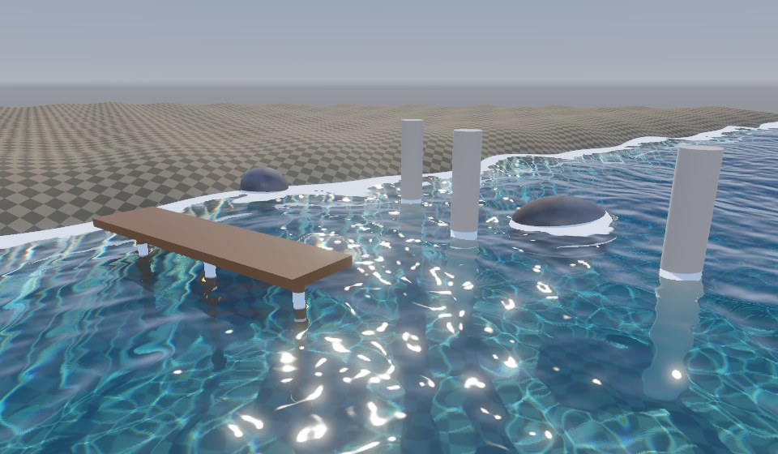
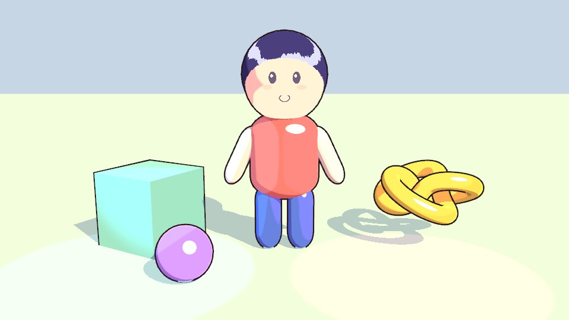
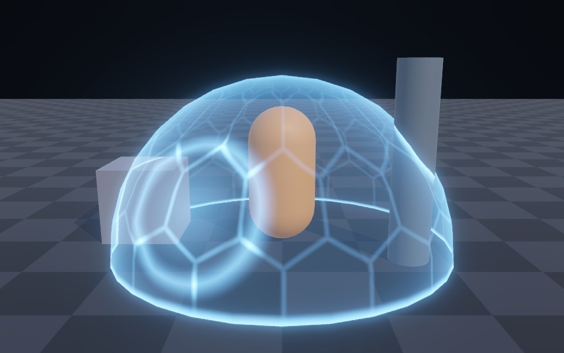
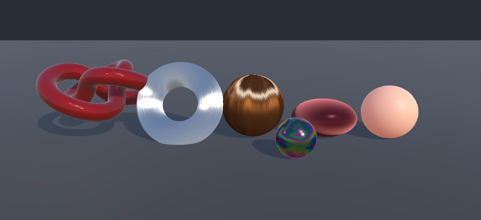
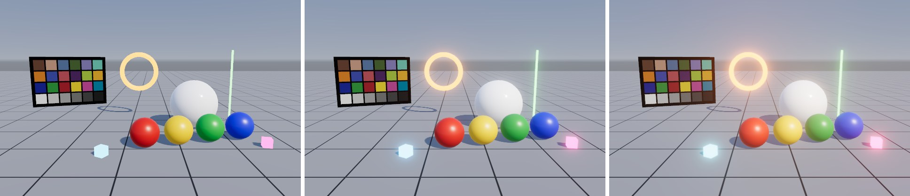
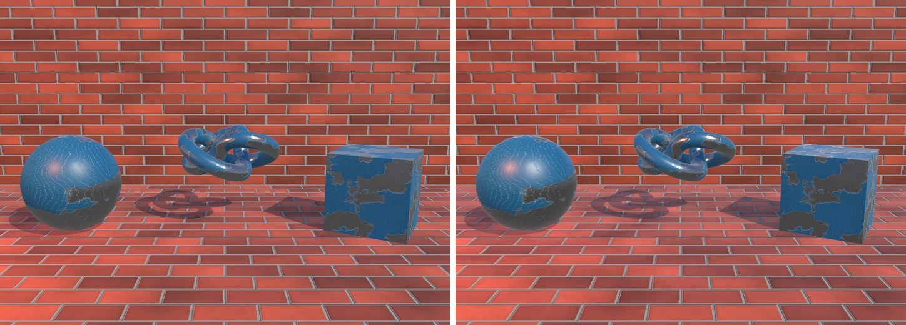

# URP 渲染实战 · Unity URP Shader、PBR 与效果案例

> **English** — Companion code for *URP Rendering in Practice*: 30 chapters and 234 shader recipes for **Unity 2022.3 LTS + URP 14 (HLSL)**, from your first URP shader to lighting, shadows, hand-written PBR, toon shading, stylized water, dissolve / hologram / shield, decals, Renderer Features and custom post-processing. Every effect runs live in the browser (a WebGL2 "mini URP" port) with tweakable parameters: **https://gametech.byte888.com/urp/en/**. Code comments are in Chinese. MIT licensed.

《URP 渲染实战》的配套代码：**Unity 2022.3 LTS + URP 14** 下的 30 章、234 个渲染案例，从第一个 URP Shader 写到光照、阴影、PBR、卡通渲染、水、溶解、贴花、Renderer Feature 与后处理。

**👉 在线阅读（每个效果都能在浏览器里实时预览、调参数、改代码）：https://gametech.byte888.com/urp/**

- 案例目录：https://gametech.byte888.com/urp/cases.html
- 更多技术专栏：https://gametech.byte888.com/

| | | |
|---|---|---|
|  |  |  |
| [风格化水面（第 19 章）](https://gametech.byte888.com/urp/c19.html) | [卡通渲染（第 14 章）](https://gametech.byte888.com/urp/c14.html) | [溶解、全息与护盾（第 18 章）](https://gametech.byte888.com/urp/c18.html) |
|  |  |  |
| [清漆、各向异性、布料、皮肤（第 12 章）](https://gametech.byte888.com/urp/c12.html) | [URP 内置后处理（第 27 章）](https://gametech.byte888.com/urp/c27.html) | [从零手写 PBR（第 11 章）](https://gametech.byte888.com/urp/c11.html) |

## 仓库内容

| 目录 | 内容 |
|---|---|
| [`unity/`](unity/) | 配套 Unity 工程（HLSL）。每章代码在 `Assets/Cookbook/ChNN/`，Shader 名以 `Cookbook/ChNN/` 开头；`Assets/Cookbook/_Core/` 是公共工具和程序化贴图 |
| [`web/`](web/) | 网页版：WebGL2 实现的“迷你 URP”渲染器 + 全书 Shader 的 GLSL 移植 + Renderer Feature / 脚本的 JS 移植（在线站点的实时预览就是它） |

## 打开 Unity 工程

1. 用 Unity Hub 以 **Unity 2022.3.x**（作者环境 2022.3.62f3）打开 `unity/` 文件夹，首次打开会自动下载 URP 14 等包。
2. 菜单 **Cookbook → Setup Project**：创建 URP Asset 并切到线性色彩空间（工程已带一份，可跳过）。
3. 在 `Assets/Cookbook/ChNN/` 里找到对应章节的 Shader / C#，新建材质即可使用。书中配图的搭景代码在各章 `Editor/*Shots.cs`。

## 目录

| 部分 | 章节 |
|---|---|
| 地基 | 1 渲染管线与坐标空间 · 2 URP 架构与一帧的流程 · 3 第一个 URP Shader · 4 Shader 里的数学工具箱 |
| 光与影 | 5 经典光照模型 · 6 多光源与阴影 · 7 法线贴图与视差 · 8 环境光、光照贴图与反射探针 |
| PBR | 9 PBR 理论 · 10 逐行读懂 URP Lit · 11 从零手写 PBR · 12 PBR 进阶材质 · 13 材质制作与校准 |
| 风格与透明 | 14 卡通渲染 · 15 更多风格化（NPR） · 16 透明、混合与模板测试 |
| 效果工坊 | 17 顶点动画 · 18 溶解、全息与护盾 · 19 水 · 20 地形与植被 · 21 UV 动画与粒子 · 22 贴花 · 23 阴影进阶 · 24 Shader Graph |
| 屏幕之上 | 25 Renderer Feature 与 RTHandle · 26 自定义后处理 · 27 URP 内置后处理全解析 · 28 屏幕空间技术 |
| 工程化 | 29 性能优化 · 30 调试与排错 |

## 许可

代码以 [MIT 许可证](LICENSE) 发布，可自由用于你的项目（含商业项目）。书的正文与配图版权归作者所有，仅供在线阅读。

作者：麦冬 · 411827633@163.com · [GameTech 技术专栏](https://gametech.byte888.com/)
